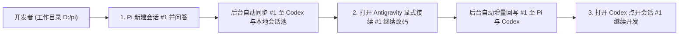

# `agent_link` — 跨 Agent 工作区会话同步系统 MVP 需求文档 (PRD)

## 1. 背景与产品目标

在日常 AI 辅助开发中，开发者常在同一项目目录（如 `D:\pi`）下交替使用 **Pi**、**Codex** 和 **Antigravity** 进行接力开发（例如：用 Pi 极简终端快速编码、用 Codex 消耗订阅额度攻坚、用 Antigravity 进行全局规划与浏览器验证）。

目前三个客户端各自将会话保存在互不相通的私有目录中，现有工具要么只能做一次性单向迁移（如 `resume-from`），要么需要手动指定会话 ID 且缺乏三端实时闭环与防爆保护。

> [!IMPORTANT]
> **MVP 核心目标**：以用户指定的「工作目录」为单位，实现该目录下 **Pi、Codex、Antigravity 所有会话的自动发现、增量共享与跨端接力**，让用户在任意一端新建或续写会话后，其余两端都能同步看到上下文并沿着最新代码状态继续工作。

---

## 2. 核心用户场景与交互流程

### 场景 1：工作目录纳管与零配置发现
- 用户将某个项目目录（如 `D:\pi`）加入同步白名单后，无需在每次新建聊天时手动执行外部绑定命令。
- 未加入白名单的其他目录完全不受影响，且被纳管项目的 Git 工作区保持零文件污染（`git status` 干净）。
- 会话严格按工作目录隔离：任何一端都只能接续本目录下的会话，误用其他目录的会话 ID 时拒绝绑定并提示，不注入任何历史。
- 电脑重启后无需手动启动后台服务：首次打开 Pi 或 Antigravity 时自动拉起，并补齐期间 Codex 侧产生的对话。

### 场景 2：「新建即纯净新建」与跨端显式接力（主流程）
1. **严格纯净新建原则**：
   - 在任意一端（Pi、Codex 或 Antigravity）点击「新建会话」并直接正常提问时，**始终开启一条 100% 纯净的全新独立会话**，绝不自动劫持或混入其他会话的历史上下文；
   - 该新会话首轮回复完成后，后台自动将其作为一条新会话同步给另外两端。
2. **Pi 发起 → Codex / Antigravity 接力**：
   - 用户在 `D:\pi` 打开 Pi 新建会话 `#1` 并完成问答后：
     - **Codex 侧**：对应 `D:\pi` 的会话列表中自动出现会话 `#1`，点开后能看到完整问答并直接续聊；
     - **Antigravity 侧**（受限于加密 `.pb` 无法从外部凭空生成侧边栏会话条目）：新窗口的模型上下文保持完全空白。用户提交首句后，聊天区显示一条**对模型不可见**的轻量提示（列出当前目录下可接续会话的短号与标题）；用户也可随时用 `agent-link status` 查看。若用户直接正常提问则为全新会话；若用户发送显式接续指令（`#link <短号>`、`#link <会话ID>` 或 `#link latest`），则将该窗口绑定至会话 `#1` 并加载前序问答继续工作。即使该窗口已作为独立会话聊过几轮，发送 `#link` 后同样改为接续目标会话，此前的独立会话单独保留。
3. **持续往返接力**：
   - 一旦某条会话已在 Antigravity 窗口绑定过（或本身就是由 Antigravity 新建发起的），后续只需在 Antigravity 侧边栏直接点开该历史会话继续发言，系统便会自动拉取并展示另外两端期间新增的轮次；
   - 已打开的 Pi 窗口在下一次发言时自动带入其他两端新增的轮次，也可执行 `/sync` 刷新界面；Codex 已打开的窗口需重进会话后才能看到新轮次；
   - Pi、Antigravity 或 Codex 回复完毕后，新增轮次同样自动增量回写至其余两端对应的原会话中。

### 场景 3：意外并发分叉的非破坏性保护（兜底流程）
- 若用户在某一端尚未收到最新同步前，基于旧节点 `S` 各自在两端续写了 `A` 和 `B`：
  - 系统**绝不覆盖、截断或丢弃任何一端的聊天记录**；
  - 自动将该会话标记为分叉状态（`[fork]`），用户可通过极简命令选择保留某一分支继续，或写入一句合并决定（如「保留 A 的实现，合入 B 的测试」）让三端汇合；
  - 选定或合并后，三端各自的下一轮对话都从选定节点继续：落选端会收到一条分支裁决说明（哪些轮次作废、采纳了哪些内容），不会沿旧分支续写而立刻再次分叉。

### 场景 4：代码变更感知与防幻觉提醒
- 当上一端修改了代码文件后（包括改完并已 `git commit` 的情况），切换到下一端继续对话时，系统自动向模型附带「工作区变更文件清单」与「此前旧测试/构建结果已作废，请以当前磁盘文件为准」的强提示，防止模型依据过时上下文胡乱修改；
- 同一端在自己一轮回复中修改文件不会触发该提示。

---

## 3. MVP 范围界定（最小实现原则）

为了用最少代码跑通核心价值并保证稳定性，第一版严格划分边界：

| 维度 | MVP 必做范围 (In-Scope) | MVP 明确不做 (Out-of-Scope / 延后) |
| :--- | :--- | :--- |
| **运行范围** | 单机本地同步（支持 Windows / macOS / Linux），按目录白名单开启 | 跨机器云端同步、多用户团队共享 |
| **支持客户端** | Pi (`pi-coding-agent`)、OpenAI Codex (CLI / Desktop)、Google Antigravity (CLI / IDE / 2.0) | 其他客户端（预留适配器接口，v2 再接 Claude Code 等） |
| **同步内容粒度** | **完整用户提问 + 完整助手最终回复 + 紧凑工具执行摘要**（改动文件与行号统计、命令退出码及报错尾部摘要） | 搬运几百行的 `read_file` 原始文本、全量终端刷屏输出、Base64 图片流 |
| **工具调用表达** | 跨端投影统一采用标准消息 + 结构化执行摘要块 | 伪造对端私有的原生工具调用 AST（不伪造 `apply_patch`、`encrypted_content` 或加密 `.pb`） |
| **已开窗口刷新** | Pi：官方扩展在下次发言前把跨端新轮次带入上下文，`/sync` 命令手动刷新界面；Antigravity：通过官方 Hook 在每轮发言时注入；Codex：重进 `/resume` 或切换侧边栏重读 | 注入/破解 Codex 或 Antigravity 桌面端 Electron 内存态以强推 UI 气泡；Pi 在事件回调中强制切换会话 |
| **分支与合并** | 单工作目录接力为主；出现分叉时保留双分支并支持命令行 `select`（二选一）与 `merge -m`（文本决策合并），执行后三端自动收敛到选定节点 | 图形化分支树合并器、自动创建多 Git Worktree 编排、细粒度单轮 Cherry-pick |
| **运行环境** | Node.js `>= 22.13.0`（使用内置 `node:sqlite`，无原生依赖）；后台服务按需自动拉起，可选开机自启 | 兼容更低 Node 版本 |
| **规则与技能共享** | 统一遵循项目根目录 `AGENTS.md` 与 `.agents/skills/` 约定 | 复杂的私有插件配置双向翻译器 |

---

## 4. 非功能性需求与防爆红线

> [!WARNING]
> 跨三端同步若缺乏限流与防环设计，极易引发物理内存飙升、模型 Token 额度暴涨或回声死循环。以下四项指标为 MVP 上线的硬性门槛。

1. **物理内存红线（RAM 防爆）**
   - 后台守护进程常驻内存不超过 **80 MB**；
   - 严禁全量读取历史 `.jsonl` 文件进内存，必须基于字节偏移量（`byte_offset`）流式读取新增片段；单行超过 **2 MB**（如内嵌大图或巨型日志）自动流式跳过正文提取。
2. **上下文窗口红线（Token 防爆）**
   - 严格按游标**仅同步未读增量轮次（Delta-Only）**，禁止重复灌入全量历史；
   - 单次跨端注入以**最终输出文本**计数，硬上限 **12,000 字符**；预算内最多保留最近 **5 轮**完整对话，单轮过长时压缩该轮正文，更早的未读轮次自动折叠为文件变更清单 + 结论摘要；
   - 跨端历史以带来源与角色标注的「历史记录」形式提供给模型，明确不作为指令。
3. **防死循环熔断（Loop & Disk 防爆）**
   - 所有同步写入内容必须可按原轮次 ID 整组识别（包括写入中途进程退出后重启的情况），读取游标只推进到已逐条处理的位置，绝不跳过任何一端尚未读取的本地对话；
   - 内置频率熔断器：同一会话在 **10 秒内触发超过 5 次同步** 时立即挂起该会话的对外同步并告警（仍继续记录各端新对话），杜绝指数级循环复写；用户执行 `agent-link resume <会话ID>` 恢复并补齐积压；
   - 后台服务不可用时，Antigravity Hook 与 Pi 扩展必须快速放行，不阻塞任何客户端的正常对话。
4. **数据安全红线**
   - 对原生会话文件仅执行追加（Append-only）或新建镜像，修改前自动保存增量备份（保留滚动上限不超过 **100 MB**）。

---

## 5. MVP 验收标准 (Acceptance Criteria)

1. **三端四跳闭环验收**：在测试目录 `test-proj` 下依次执行 `Pi 新建问答 -> Antigravity 新建承接并追问改码 -> Codex 打开对应会话追问 -> 回到 Antigravity 原窗口追问`，每一跳模型均能准确复述上一端结论并感知最新文件改动。
2. **幂等性验收**：无新对话产生时，连续重启守护进程或手动触发同步 3 次，三端会话文件大小与内容哈希保持零变化。
3. **防回声验收**：任意一端完成回复后，仅触发一次向另外两端的单向扇出，不会反向回流产生重复消息。
4. **大文件低内存验收**：构造一个含 100 MB 历史工具输出的模拟 `.jsonl` 会话并追加 1 轮新问答，守护进程增量同步峰值内存增量 `< 30 MB`，耗时 `< 1s`。
5. **分叉零丢失验收**：暂停守护进程，在 Pi 与 Codex 基于同一进度各自新增 1 轮问答后恢复守护进程，会话状态转为 `DIVERGED`，两端各自新增内容完整保留，无覆盖丢失；执行 `select` 后三端各再续写 1 轮，会话保持 `SYNCED`，不再次分叉。
6. **Codex 可读验收**：同步生成或追加的 Codex 会话，通过 Codex 官方接口读取（`thread/read(includeTurns=true)`）时，轮数与写入轮数一致，且每轮包含用户与助手两条消息。
7. **写入中断不回流验收**：模拟「同步内容已写入原生文件、游标尚未提交」时进程退出，重启后该内容不会被当作新对话再次同步。
8. **目录隔离验收**：在目录 B 的 Antigravity 窗口发送目录 A 会话的 `#link`，绑定被拒绝且模型未收到任何目录 A 的历史。
9. **代码漂移验收**：一端改动文件并 `git commit` 后切到另一端，模型收到变更提醒；Antigravity 在同一轮内自行改文件、跑测试，不会收到变更提醒，也不会陷入反复重读重测。
